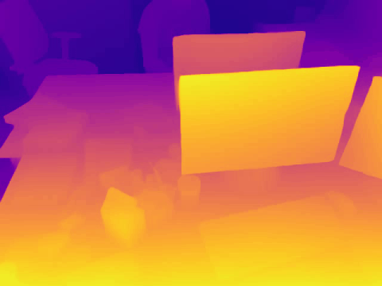
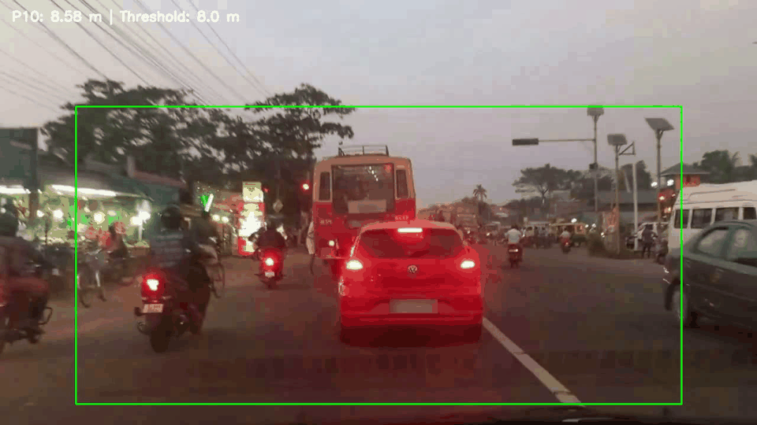

# Depth Anything — Results

This folder contains the main experimental outputs of the Depth Anything project, including model comparison results, per-image evaluation metrics, video depth estimation, and the proximity warning system.

## 1. Results Overview

### ⚖️ 1.1. Model Trade-off Analysis

**Folder:** `DepthAnything_models_Trade-off_results/`

This folder contains the quantitative evaluation results for Depth Anything V2 Small and Base on eight RGB-D image pairs from the Depth8 dataset.

| File | Description |
|---|---|
| `depth_anything_model_comparison.csv` | Summary of model performance, including depth estimation errors, processing time, FPS, and GPU memory usage. |
| `depth_anything_per_image_results.csv` | Per-image evaluation results for a detailed comparison between the Small and Base models. |

The comparison evaluates the trade-off between depth estimation accuracy and computational efficiency. The Base model achieves slightly lower depth estimation errors, while the Small model offers faster processing and lower GPU memory consumption.

> **Note:** Only eight image pairs were used in this experiment. The results are useful for testing and comparing the implemented pipeline, but should not be interpreted as a comprehensive benchmark of the models.

<a id="video-depth-estimation"></a>
### 🎞️ 1.2. Video Depth Estimation

**File:** `DepthAnything_videoOutput_short.gif`

The following GIF presents a short visualization of video depth estimation using Depth Anything V2.

<p align="center">
  
</p>

The experiment uses the `freiburg1_xyz` sequence from the TUM RGB-D dataset. RGB frames are processed to estimate depth maps, allowing the model's output to be examined across a video sequence.

The GIF is a short project-generated visualization, not an original depth video distributed by the dataset provider.

### 🚗 1.3. Proximity Warning System

**Folder:** `DepthAnything_warning_sys/`

This folder contains the outputs of the video-based proximity warning experiment using Depth Anything V2 Metric Small and Roadscapes driving footage.

| File | Description |
|---|---|
| `DepthAnything_ProximityWarning_results.csv` | Quantitative results from the proximity warning experiment, including frame-level warning information and estimated proximity values. |
| `Sequence_Day_11_metric_warning_36_to_42.gif` | Small GIF visualization of the proximity warning system operating on the Roadscapes video sequence. |

<p align="center">
  
</p>

The system estimates metric depth, analyzes a selected region of interest (ROI), and uses the 10th percentile (P10) of valid depth values as a proximity indicator. A warning is activated when this value falls below the selected threshold for the required number of consecutive frames.

The threshold and warning logic were selected experimentally for this project. The system is intended as a computer vision demonstration and has not been validated as a safety-critical driving system.

---

## 2. Datasets

Three datasets were used in the project. Each supports a different stage of the experiments.

### 📚 2.1. Depth8 Dataset

#### Description

The [Ultralytics Depth8 dataset documentation](https://github.com/ultralytics/ultralytics/blob/main/docs/en/datasets/depth/depth8.md) describes a compact collection of eight indoor RGB-D image pairs sampled from the SUN RGB-D dataset. It contains four training images and four validation images captured using Kinect v1 and Kinect v2 sensors, paired with dense ground-truth depth maps.

#### Use in This Project

Depth8 was used for:

- **Phase 1:** Single-image depth estimation.
- **Phase 2:** Numerical analysis of predicted depth maps.
- **Phase 3:** Comparison of Depth Anything V2 Small and Base.
- **Phase 6:** Near, medium, and far object analysis using selected regions of interest.

#### Limitation

Depth8 is intended for pipeline testing and debugging rather than comprehensive benchmarking. Its eight image pairs are insufficient for a broad evaluation of model performance. Results obtained using this dataset should therefore be interpreted as small-scale experimental results.

#### Attribution and License

**Dataset:** [Ultralytics Depth8](https://github.com/ultralytics/ultralytics/blob/main/docs/en/datasets/depth/depth8.md)

Depth8 contains eight RGB-D image pairs sampled from the [SUN RGB-D dataset](https://github.com/ultralytics/ultralytics/blob/main/docs/en/datasets/depth/sunrgbd.md). The cited documentation does not specify a license for the underlying dataset.

The experiments in this project use Depth8 for small-scale testing and analysis. The repository contains the experimental notebooks, reports, CSV results, and generated visualizations; the original Depth8 image pairs are not redistributed.

When using this dataset, please acknowledge the original SUN RGB-D dataset and cite the following publication.

**Dataset paper:**

S. Song, S. P. Lichtenberg, and J. Xiao, “SUN RGB-D: A RGB-D Scene Understanding Benchmark Suite,” *Proceedings of the IEEE Conference on Computer Vision and Pattern Recognition (CVPR)*, 2015.

```bibtex
@inproceedings{song2015sunrgbd,
  title={SUN RGB-D: A RGB-D Scene Understanding Benchmark Suite},
  author={Song, Shuran and Lichtenberg, Samuel P. and Xiao, Jianxiong},
  booktitle={Proceedings of the IEEE Conference on Computer Vision and Pattern Recognition (CVPR)},
  year={2015}
}
```

For reuse or redistribution of original dataset content, consult the source documentation and applicable permissions before proceeding.

### 🎞️ 2.2. TUM RGB-D Dataset

#### Description

The [TUM RGB-D dataset](https://cvg.cit.tum.de/data/datasets/rgbd-dataset), provided by the Technical University of Munich, contains RGB-D sequences and ground-truth information for research in visual odometry and simultaneous localization and mapping (SLAM).

#### Use in This Project

The `freiburg1_xyz` sequence was used in:

- **Phase 4:** Frame-by-frame depth estimation using Depth Anything V2 Small.
- **Phase 5:** Visualization of colorized depth maps and RGB/depth overlays.

The experiment processed 798 frames at a resolution of 640 × 480 pixels. The source sequence runs at approximately 30 FPS and covers about 26.6 seconds.

The generated depth visualization is a project output, not an original TUM RGB-D depth video.

The generated depth visualization is available in [Section 1.2](#video-depth-estimation).

#### Attribution and License

**Dataset:** TUM RGB-D Dataset, Technical University of Munich.

**Official source:** [RGB-D SLAM Dataset and Benchmark](https://cvg.cit.tum.de/data/datasets/rgbd-dataset)

The official TUM RGB-D page states that, unless otherwise indicated, the dataset data is licensed under the **Creative Commons Attribution 4.0 International License (CC BY 4.0)**. The accompanying source code has a separate BSD-2-Clause license.

When using or redistributing the original data or materials derived from it, consult the [official dataset page](https://cvg.cit.tum.de/data/datasets/rgbd-dataset) for the applicable terms and provide appropriate attribution.

#### Dataset Paper

J. Sturm, N. Engelhard, F. Endres, W. Burgard, and D. Cremers, “A Benchmark for the Evaluation of RGB-D SLAM Systems,” *IEEE/RSJ International Conference on Intelligent Robots and Systems (IROS)*, 2012.


### 🚗 2.3. Roadscapes Video Dataset — Day 11

#### Description

The [Roadscapes Video Dataset](https://huggingface.co/datasets/vijpandaturtle/roadscapes-video) contains dashcam video footage from driving scenes.

For Phase 7, the Day 11 footage was processed using **Depth Anything V2 Metric Small (ViT-S)** to generate depth maps and evaluate an ROI-based proximity warning system.

The original footage was trimmed to the interval from 6 to 50 seconds, producing a 44-second clip with the following properties:

| Property | Value |
|---|---|
| Duration | 44 seconds |
| Number of frames | 1,320 |
| Resolution | 1280 × 720 pixels |
| Input frame rate | 30 FPS |
| Selected source interval | 6–50 seconds |

#### Use in This Project

The experiment used the 10th percentile (P10) of valid depth values within a selected region of interest as a proximity indicator. Warnings were activated or cleared using an 8.0 m threshold and a three-consecutive-frame rule.

The generated results include the proximity-warning visualization and a CSV file containing the quantitative results.

These are project-generated outputs, not original Roadscapes dataset files.

#### Attribution and License

**Dataset:** Roadscapes Video Dataset, specifically Day 11.

**Source:** [Roadscapes Video Dataset on Hugging Face](https://huggingface.co/datasets/vijpandaturtle/roadscapes-video)

The dataset card specifies the **Creative Commons Attribution-NonCommercial 4.0 International License (CC BY-NC 4.0)**.

This license requires appropriate attribution and restricts commercial use under its terms. Before redistributing or reusing the original footage or derived materials, review the [full license](https://creativecommons.org/licenses/by-nc/4.0/) and the [original dataset card](https://huggingface.co/datasets/vijpandaturtle/roadscapes-video).

#### Dataset Citation

The following is a suggested BibTeX-style entry based on the dataset's Hugging Face page. Check the dataset card for any preferred citation before using it in formal publications.

```bibtex
@dataset{roadscapes_video,
  author    = {vijpandaturtle},
  title     = {Roadscapes Video Dataset},
  year      = {2025},
  publisher = {Hugging Face},
  url       = {https://huggingface.co/datasets/vijpandaturtle/roadscapes-video}
}
```

---

## 3. Important Notes

- **Relative versus metric depth:** The standard Depth Anything V2 model produces relative depth estimates, which should not automatically be interpreted as physical distances in meters. Metric depth estimation is used for the proximity warning experiment.
- **Evaluation scope:** The quantitative model comparison uses only eight Depth8 image pairs and does not establish general performance across all scenes or datasets.
- **Computational performance:** Processing speed depends on the model, hardware, input resolution, and processing pipeline. The reported FPS values should be interpreted in the context of the experimental setup.
- **Proximity threshold:** The 8.0 m threshold is an experimental parameter, not a validated international safety standard or a universally applicable safe-distance threshold.
- **Dataset terms:** Consult the original dataset documentation and license information before redistributing dataset files or derived content. The inclusion of results in this repository does not change the original datasets' licensing conditions.

## 4. Reproducibility

The CSV files provide quantitative results, while the GIFs offer visual examples of the model outputs. The accompanying notebooks and code in the main project directory document the experimental procedures and implementation.

For the complete workflow, refer to the main project README and the associated notebooks.
